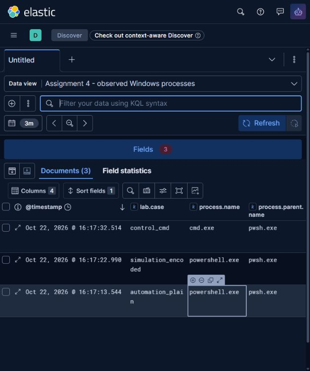
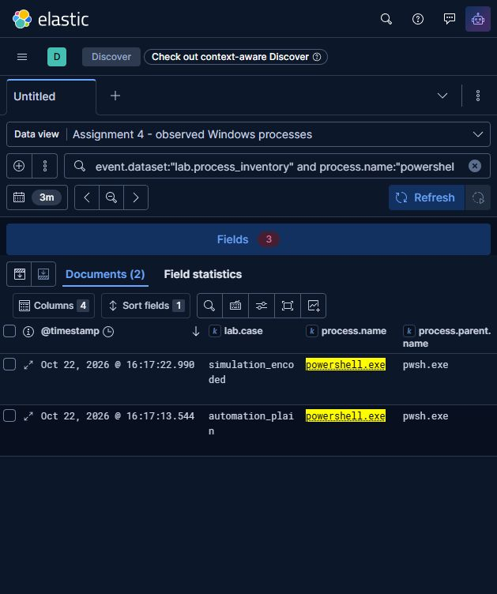

# Assignment 4: ATT&CK technique simulation and MITRE CAR in Elastic

Project: Forensic Analysis and Detection of Simulated Infostealer-Like Activity in Windows Environments.

Date: 22 October 2026. Practical run: `20261022T111712644Z`. This report covers Weeks 6-7 and continues the earlier PowerShell hunt with newly collected observations on the replacement PC.

## Requirements and completed increment

The supplied syllabus, section 3.3, PDF page 7, requires studying a specific ATT&CK technique, performing a simulation and mapping the results in Week 6. Week 7 requires selecting a MITRE CAR analytic, implementing it in a SIEM and mapping it to ATT&CK. The original syllabus is retained locally under `restored-context/references/` outside this repository.

| Requirement | Evidence in this increment |
| --- | --- |
| Study one ATT&CK technique | PowerShell T1059.001, its Execution tactic, behavior and limitations below |
| Simulate activity and map observed results | Encoded PowerShell reads a newly generated mock browser JSON file and copies it into a local staging file; command output, native Event 400 XML, live process inventory and matching file hashes retained |
| Select a CAR analytic | CAR-2014-04-003, Powershell Execution |
| Implement the analytic in a SIEM | Disclosed inventory-data adaptation executed in Elasticsearch 9.5.5, with a Kibana 9.5.5 data view and Discover verification |
| Map analytic and results to ATT&CK | T1059.001 / T1059, Execution; no claim of demonstrated Defense Evasion |

## Week 6: technique and simulation

[MITRE ATT&CK T1059.001](https://attack.mitre.org/techniques/T1059/001/) describes adversary use of PowerShell for command and script execution. It belongs to T1059, Command and Scripting Interpreter, and the Execution tactic. PowerShell also supports legitimate administration, so its execution is contextual evidence rather than proof of compromise. The current technique page was checked on 22 October 2026.

The lab models one execution step relevant to infostealer research. The collector creates `mock-browser.json` with explicit training values (`FAKE-STUDENT`, `NOT-A-REAL-PASSWORD`, `https://training.invalid`). The encoded case reads only that file, copies it to `staged-mock-browser.json`, prints a unique run marker and waits briefly for observation. Matching SHA-256 values confirm that the local staging copy has the same bytes. A zero exit code and exact marker confirm completion of the requested command. No real browser profile, credentials or external destination is used. The cmd control sends only loopback pings to remain observable.

Three independently labelled cases were collected:

| Case | Observed image | Observed parent | Expected CAR outcome | Actual outcome |
| --- | --- | --- | --- | --- |
| `automation_plain` | `powershell.exe` | `pwsh.exe` | Match: legitimate automation | Match |
| `simulation_encoded` | `powershell.exe` | `pwsh.exe` | Match: benign training simulation | Match |
| `control_cmd` | `cmd.exe` | `pwsh.exe` | Excluded: different executable | Excluded |

All three processes exited with code 0. Native PowerShell Event 400 record IDs are 28093 for plain automation and 28101 for encoded simulation. These XML records corroborate the PowerShell launches; the parent relationship comes from separate live `Win32_Process` observations. The collector itself executes under `pwsh.exe`.

| Behavior | ATT&CK interpretation | Evidence and qualification |
| --- | --- | --- |
| PowerShell executes the controlled commands | T1059.001, Execution | Recorded image, command line, native Event 400 and marker output |
| PowerShell launched with an encoded command | Invocation variant within the experiment | Encoding is decoded for review; it is not proof of malicious intent or successful evasion |
| Local mock-file staging | Project-specific harmless simulation step | Source/destination hashes and command line; no additional credential-theft or exfiltration technique is claimed |
| Cmd negative control | Outside this PowerShell analytic | Collected only as a negative selection control; no attack-technique claim |

The simulation establishes that the controlled execution occurred. It does not establish a real infection, credential theft, C2 communication or exfiltration. The mock-file copy is an outcome artifact, not a file-access telemetry stream.

## Week 7: CAR selection and adaptation

[MITRE CAR-2014-04-003](https://car.mitre.org/analytics/CAR-2014-04-003/) selects PowerShell process creation whose parent is not Explorer. Its required fields describe the executable and its parent; the published examples include Sysmon-based implementations. The lab preserves the executable/parent predicate but explicitly changes the input from process-creation events to observations of controlled live processes. The CAR page was checked on 22 October 2026.

Sysmon was absent on this PC and the current session could not read Security events without elevation. The collector therefore records actual process inventory while each known child remains alive. These observations are indexed as `event.dataset=lab.process_inventory`, `event.action=process_observed` and `event.type=info`. They are never labelled as Sysmon Event 1, Security Event 4688 or a continuous process-create stream.

This is an implementation of the CAR selection logic on a disclosed alternative data source. It does not demonstrate the original process-creation sensor coverage. Short-lived processes can be missed, unrelated launches are not monitored, and the lab's same-session parent lookup is not a production process-GUID correlation method. A deployment intended for endpoint detection should replace the inventory collector with a process-creation sensor.

The Elasticsearch Query DSL is saved in `hunt-queries.json`. Its conditions are:

```text
event.dataset = lab.process_inventory
AND process.name = powershell.exe
AND process.parent.name exists and is nonempty
AND process.parent.name != explorer.exe
```

Executable-name fields use a lowercase keyword normalizer. The explicit parent-presence guard prevents incomplete records from becoming matches. The query does not select by case label, encoded flag, expected outcome or mock-file content.

Equivalent KQL used in Discover:

```text
event.dataset:"lab.process_inventory" and process.name:"powershell.exe" and process.parent.name:* and not process.parent.name:"explorer.exe" and not process.parent.name:""
```

Elasticsearch returned **3 inventory observations -> 2 PowerShell observations -> 2 CAR candidates**. The candidates are the encoded simulation and the plain legitimate automation. Both candidates are benign in this controlled experiment. The match identifies a process relationship worth review; it does not identify which case staged the mock file. The original CAR page retains historical Defense Evasion mapping; the current T1059.001 mapping and this experiment support Execution.

Six explicitly synthetic boundary cases were indexed separately under the `-regression` index: ordinary automation (match), Explorer parent (excluded), cmd image (excluded), missing parent (excluded), empty parent (excluded), and uppercase executable/parent names (match). All six returned their expected selection result. These fixtures test query semantics and are not included in the three observed endpoint records. No successful local Explorer-parent launch is claimed: an earlier attempted shell control produced a `pwsh.exe` parent and its incomplete collection directory is excluded from this report's evidence set.





## Evidence and provenance

All authoritative files for this report are under `evidence/assignment4/20261022T111712644Z/`:

| Files | Purpose |
| --- | --- |
| `collection-manifest.json`, `collection-sha256.json` | Run identity, collector hash, case outcomes and original collection hashes |
| `*.cim.json` | Raw selected live process and parent properties |
| `*.event400.xml` | Native Event 400 XML for both observed PowerShell launches |
| `*.stdout.txt`, `*.stderr.txt` | Captured decoded output/error text; encoded PowerShell stderr contains module-initialization CLIXML progress, not a failing exit status |
| `mock-browser.json`, `staged-mock-browser.json` | Synthetic input and verified staging artifact |
| `process-observations.jsonl`, `case-labels.json` | Normalized real observations and independently assigned expected outcomes |
| `hunt-queries.json`, `hunt-results.json` | Executed selection queries and full Elasticsearch responses |
| `siem-api-transcript.json`, `siem-runtime.json` | Timestamped SIEM calls/responses and server-reported runtime information |
| `regression-results.json`, `validation-summary.json` | Isolated fixture outcomes and case-level validation |
| `siem-sha256.json` | Hash inventory after SIEM execution |

The earlier `week6-pilot/` and incomplete `assignment4/20261022T111540875Z/` directories are development records. They are not substituted for the authoritative completed collection. Historical Week 5 evidence remains attributable to the previous experiment and is not used as new telemetry here. Local command lines contain workspace paths; review those before any public release.

Output streams are decoded by .NET before being saved. Localized CLIXML progress text in the encoded case contains decoding replacement characters; it is retained as captured and is not represented as byte-exact native process output. The ASCII marker, exit status, native XML and file hashes provide the outcome checks. Repository attributes preserve the collected files and hashed collector bytes without line-ending conversion.

## Reproduction and demonstration

The new Compose project is `threat-hunting-assignment4`, with its own network and data volume. Elasticsearch is bound to `127.0.0.1:19200`; Kibana is at `http://127.0.0.1:15601`. Both containers reported healthy during validation. Existing MISP containers remain a separate project.

From the repository root, with Docker Desktop running and Python 3.9+ available:

```powershell
docker compose -f docker/assignment4-compose.yml up -d --wait
pwsh -NoProfile -File scripts/collect_assignment4.ps1
python scripts/run_assignment4.py evidence/assignment4/<NEW_RUN_ID>
```

Use the new directory printed by the collector. Each collection gets its own run ID, ES index and data view. Run the SIEM loader once per collection: it deliberately refuses to overwrite an existing index. To repeat ingestion, create another collection first. On this PC the bundled Python executable can be used if `python` resolves only to a Windows Store alias.

For the preserved run, select the data view **Assignment 4 - observed Windows processes**, with exact title `lab-assignment4-20261022t111712644z`. Use absolute UTC time **22 October 2026 11:16-11:19**, equivalent to **16:16-16:19 Asia/Qyzylorda**. Display `lab.case`, `process.name` and `process.parent.name`; first show the three inventory records, then apply the KQL above and show the two candidates. A relative last-15-minutes range will stop showing these records later.

## Interpretation and limits

The practical result is the successful execution of a small controlled simulation and the tested SIEM implementation of an adapted CAR predicate. With only three benign cases, the work cannot estimate production precision, recall or false-positive rates. Parent-based selection misses PowerShell under Explorer, renamed executables, `pwsh.exe` variants not selected by this original condition, and execution through .NET without `powershell.exe`. The live-inventory collector adds short-process and collection-window blind spots. Scheduled alerting and production sensor integration were not configured.

The legitimate automation match is deliberate: reviewing the command and known training context is necessary to interpret both hits. The report provides observed outcomes and explicit coverage limits instead of treating the hit count as evidence of malware detection.

## Assistance and submission status

OpenAI Codex assisted with requirement interpretation, code, lab execution, validation, report preparation and defense notes. The group should review the commands, evidence and explanations and follow the instructor's AI-use and disclosure requirements. Local preparation does not establish instructor permission.

The practical artifacts and report are prepared locally. Oral defense, instructor assessment and any GitHub publication remain separate submission steps. See [Russian defense notes](assignment4-defense-ru.md).
