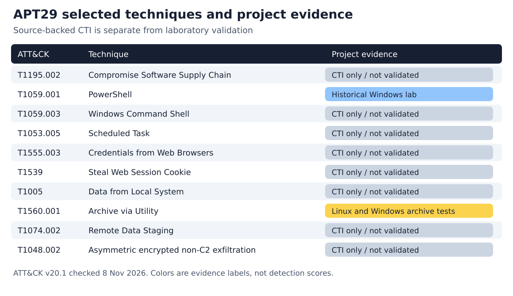

# Week 10 - APT29 TTP analysis and ATT&CK mapping

Project: **Forensic Analysis and Detection of Simulated Infostealer-Like Activity in Windows Environments**. Prepared 8 November 2026 for Introduction to Threat Hunting, syllabus 2026-2027 section 3.3, Week 10. The task is to analyze APT29 or APT41 and map the reported techniques to ATT&CK.

**Lab follow-up.** The subsequent Week 8 Windows emulation exercised local staging and an HTTP POST to 127.0.0.1 (T1048.003). The SolarWinds HTTPS procedure (T1048.002) below remains an external intelligence finding. References below to the Week 9 lab describe the earlier atomic and tar.exe datasets. [Windows chain evidence](week8-windows-run.md)

## Result and scope

We analyzed APT29, with SolarWinds as the main case and explicitly separated StellarParticle follow-on reporting. Ten selected techniques are mapped below. The practical connection is browser-data collection and archiving, but APT29 is an espionage actor: shared behaviors do not make our simulated infostealer an APT29 implant or establish attribution.

MITRE identifies APT29 as G0016 and associates it with Russia's SVR. Its SolarWinds campaign entry is C0024. These are external intelligence assessments, not findings from our laptop. [MITRE G0016](https://attack.mitre.org/groups/G0016/)

FireEye's December 2020 investigation describes the compromised Orion update mechanism and SUNBURST. Its later May 2022 update attributes the previously tracked UNC2452 activity to APT29. The report also describes temporary changes to legitimate scheduled tasks, followed by restoration. Those details support separate delivery and persistence hypotheses. [Mandiant investigation](https://cloud.google.com/blog/topics/threat-intelligence/evasive-attacker-leverages-solarwinds-supply-chain-compromises-with-sunburst-backdoor)

CrowdStrike's January 2022 StellarParticle report includes investigations extending into 2021. It reports Chrome cookie theft, access to DPAPI material and evidence of saved-password export. We keep that reporting period separate from the SolarWinds campaign timeline; it is not evidence that all of these procedures occurred in every Orion intrusion. [CrowdStrike investigation](https://www.crowdstrike.com/en-us/blog/observations-from-the-stellarparticle-campaign/)

## Evidence-qualified technique mapping

The behavior column summarizes external reporting. The application column states what our project actually demonstrates. Tactics are current ATT&CK mappings, checked on 8 November 2026. The [version history](https://attack.mitre.org/resources/versions/) identifies **v20.1**; historical source terminology is preserved only within source context. A technique can map to several tactics; that does not establish all tactical uses in the cited incident.

| Technique | Tactic | Reported behavior and source | Project evidence |
| --- | --- | --- | --- |
| [T1195.002 Compromise Software Supply Chain](https://attack.mitre.org/techniques/T1195/002/) | Initial Access | Trojanized Orion software updates delivered SUNBURST. [MANDIANT-2020](https://cloud.google.com/blog/topics/threat-intelligence/evasive-attacker-leverages-solarwinds-supply-chain-compromises-with-sunburst-backdoor) | Delivery-chain context; not executed. |
| [T1059.001 PowerShell](https://attack.mitre.org/techniques/T1059/001/) | Execution | PowerShell supported post-compromise commands and task operations. [MITRE-C0024](https://attack.mitre.org/campaigns/C0024/) | Weeks 5-7 contain the historical Windows PowerShell observations. |
| [T1059.003 Windows Command Shell](https://attack.mitre.org/techniques/T1059/003/) | Execution | cmd.exe executed commands on remote machines. [MITRE-C0024](https://attack.mitre.org/campaigns/C0024/) | Historical cmd control is not validation of remote execution. |
| [T1053.005 Scheduled Task](https://attack.mitre.org/techniques/T1053/005/) | Execution, Persistence, Privilege Escalation | Existing scheduled tasks were temporarily modified, then restored. [MANDIANT-2020](https://cloud.google.com/blog/topics/threat-intelligence/evasive-attacker-leverages-solarwinds-supply-chain-compromises-with-sunburst-backdoor) | The subsequent Week 8 emulation registered a new logon task, ran its marker on demand and deleted the task. Modification of an existing task remains a hunt hypothesis. |
| [T1555.003 Credentials from Web Browsers](https://attack.mitre.org/techniques/T1555/003/) | Credential Access | RDP Bitmap Cache reconstruction showed a Chrome export of saved passwords to plaintext CSV (CrowdStrike figure 4). [CROWDSTRIKE-2022](https://www.crowdstrike.com/en-us/blog/observations-from-the-stellarparticle-campaign/) | Mock JSON is not a browser credential store or DPAPI validation. |
| [T1539 Steal Web Session Cookie](https://attack.mitre.org/techniques/T1539/) | Credential Access | Shellbags showed Chrome and DPAPI directory navigation. Falcon identified the Cookie Editor extension used in the reported session reuse (figures 2–3). [CROWDSTRIKE-2022](https://www.crowdstrike.com/en-us/blog/observations-from-the-stellarparticle-campaign/) | Fake cookies were archived; no valid session or cookie theft was tested. |
| [T1005 Data from Local System](https://attack.mitre.org/techniques/T1005/) | Collection | Volexity recorded a 7-Zip command naming the exported local file `C:\Temp\b.pst` as its input on the OWA server. [VOLEXITY-2020](https://www.volexity.com/blog/2020/12/14/dark-halo-leverages-solarwinds-compromise-to-breach-organizations/) | Only generated lab files were read; no general collection detector. |
| [T1560.001 Archive via Utility](https://attack.mitre.org/techniques/T1560/001/) | Collection | 7-Zip created password-protected archives, sometimes split into parts. [MICROSOFT-2021](https://www.microsoft.com/en-us/security/blog/2021/01/20/deep-dive-into-the-solorigate-second-stage-activation-from-sunburst-to-teardrop-and-raindrop/) | Week 9 exercised Linux tar/gzip and Windows tar.exe on synthetic files. |
| [T1074.002 Remote Data Staging](https://attack.mitre.org/techniques/T1074/002/) | Collection | Archives were staged on a victim OWA server. [MITRE-C0024](https://attack.mitre.org/campaigns/C0024/) | Local out/ artifacts do not demonstrate remote staging. |
| [T1048.002 Exfiltration Over Asymmetric Encrypted Non-C2 Protocol](https://attack.mitre.org/techniques/T1048/002/) | Exfiltration | MITRE classifies the HTTPS retrieval as T1048.002. Volexity documents archive creation and illustrates a retrieval URL. [MITRE C0024](https://attack.mitre.org/campaigns/C0024/) · [Volexity, Exfiltration](https://www.volexity.com/blog/2020/12/14/dark-halo-leverages-solarwinds-compromise-to-breach-organizations/) | The earlier Week 9 archive tests measured local access. The later Windows run verified a plaintext loopback POST (T1048.003). |

The diagram is an original summary of the mapping table, not a screenshot of ATT&CK Navigator. The [Navigator layer](../data/week10/apt29-navigator-layer.json) provides an importable view. Its colors represent evidence type, never a detection percentage. The layer identifies major version 20; the detailed mapping was checked against the v20.1 website. The [validation record](../data/week10/attack-validation.json) confirms all ten technique names, tactics and active status against the official v20.1 STIX bundle and records its SHA-256. The [JSON](../data/week10/apt29-mapping.json) and [CSV](../data/week10/apt29-mapping.csv) retain source URLs and proposed hunts for each row.

## What transfers to the group topic

**Archive behavior is the strongest new connection.** Microsoft's investigation reports 7-Zip archive creation, including protected and split archives. Week 9 exercised that archive behavior with Linux tar/gzip and Windows tar.exe. They validate our collection and search pipeline for those commands only. They do not test Windows 7-Zip, password protection, splitting or APT29 malware. [Microsoft investigation](https://www.microsoft.com/en-us/security/blog/2021/01/20/deep-dive-into-the-solorigate-second-stage-activation-from-sunburst-to-teardrop-and-raindrop/)

**Credential access remains a visibility gap.** T1555.003 concerns browser-stored credentials; T1539 concerns session cookies. A fake JSON file containing training strings is neither an encrypted browser store nor an authenticated session. The presence of `cookies.json` inside a test archive must not be described as demonstrated cookie theft. The two source-reported behaviors justify future sensor work, not a completed detection claim. [T1555.003](https://attack.mitre.org/techniques/T1555/003/), [T1539](https://attack.mitre.org/techniques/T1539/)

**Interpreter identity matters.** T1059.004 in Week 9 is Unix Shell. It cannot be relabelled T1059.001 PowerShell or T1059.003 Windows Command Shell. The Linux shell test is excluded from the APT29 layer because this evidence set does not establish that procedure for APT29. Earlier Windows PowerShell evidence remains historical and is linked in the [Weeks 6-7 report](week_6-7.md).

## T1005 and the local PST on the OWA server

Volexity investigated the July 2020 intrusion at a US think tank and published two command lines. An Exchange export request directed selected mailbox messages to a file named `b.pst`. A later `7z.exe` invocation on the OWA server named `C:\Temp\b.pst` as its input and `Redir.png` under the OWA web directory as its archive output. The PST operand is the concrete basis for treating a local file as a collection source. The publication supplies command evidence and an incident narrative. It does not publish a per-file read audit event. Volexity calls the actor Dark Halo; MITRE cites this investigation as reference 5 for T1005 in C0024. [Volexity, SolarWinds / Exfiltration](https://www.volexity.com/blog/2020/12/14/dark-halo-leverages-solarwinds-compromise-to-breach-organizations/) · [MITRE C0024](https://attack.mitre.org/campaigns/C0024/)

| Investigator’s question | Evidence and interpretation |
| --- | --- |
| Where did the data come from? | Mailbox export is remote email collection (T1114.002). Once exported, the PST on disk is the local input relevant to T1005. |
| What happened to the file? | The 7-Zip command identifies compression (T1560.001). Placement on the victim’s OWA server provides the staging context (T1074.002). |
| Did data leave the environment? | MITRE reports retrieval via HTTPS. Volexity describes the exfiltration and illustrates a URL. Independent verification would require a matching request and response that served the archive. |

For a Windows hunt, match a read of the PST (Security 4663 with ReadData and appropriate auditing) to the 7-Zip PID on the same host and within its lifetime. Check the output path and web access separately. Our group’s Linux and Windows fixtures demonstrate access to synthetic inputs only; the Exchange incident remains an external observation.

## T1048.002 and the OWA retrieval

MITRE maps APT29’s retrieval of a password-protected archive from a victim OWA server over HTTPS to T1048.002 in campaign C0024. Its reference 5 is Volexity’s investigation. The two publications therefore share the same underlying incident evidence. [MITRE C0024](https://attack.mitre.org/campaigns/C0024/)

Volexity reports email exfiltration. It publishes the 7-Zip command placing the archive at `owa\auth\Redir.png`, describes collection by a web request and gives an example HTTPS URL ending in `/owa/auth/Redir.png`. The example identifies a path an investigator could search. The article supplies no IIS access-log entry, response status or byte count for that URL. [Volexity, Exfiltration](https://www.volexity.com/blog/2020/12/14/dark-halo-leverages-solarwinds-compromise-to-breach-organizations/)

To corroborate a download, correlate archive creation with an IIS or reverse-proxy entry for that URI. Check client address, UTC time, response status and bytes served against the archive size. The Week 9 Security records show a local archive command and a file read. The separate Windows chain captured a plaintext loopback upload. Neither dataset covers an HTTPS download from OWA.

## Windows artifacts and their evidentiary limits

**Group evidence, 22 October 2026.** The native Windows PowerShell log contains Event 400, record 28101, for PID 12292 at 11:17:22.8355311 UTC. The engine became available with an encoded command. A CIM sample at 11:17:22.9908514 UTC identifies the same process and its parent, pwsh.exe (PID 2732). The recorded command, unique stdout marker and identical SHA-256 of the staged and source mock files (`6a7855797fb3c8418ba6570f461c8eeefbfc8aa8d266d4eb1e62148aa2f5ec8b`) support a successful local copy. The evidence establishes a PowerShell launch and its outcome. It cannot identify a separate file-read event, Chrome credential access or network transfer. [Event XML](../evidence/assignment4/20261022T111712644Z/simulation_encoded.event400.xml) · [CIM sample](../evidence/assignment4/20261022T111712644Z/simulation_encoded.cim.json) · [Marker](../evidence/assignment4/20261022T111712644Z/simulation_encoded.stdout.txt) · [File hashes](../evidence/assignment4/20261022T111712644Z/collection-sha256.json)

| Reported APT29 procedure | Windows artifact in the investigation | What an analyst can conclude |
| --- | --- | --- |
| T1555.003 · Export saved Chrome passwords | Reconstructed RDP Bitmap Cache showed the Chrome password export to a plaintext CSV (figure 4). | The display evidence supports export during the observed session. Establishing subsequent use or transfer requires additional evidence. |
| T1539 · Obtain and reuse Chrome cookies | Shellbags recorded navigation through Chrome profile and DPAPI directories. Falcon NewScriptWritten telemetry identified the Cookie Editor extension by its ID (figures 2–3). | Directory navigation and extension activity corroborate the investigators’ reconstruction. Shellbags alone do not establish file copying, decryption or session reuse. The responders assessed that decryption likely occurred offline. |

Source for both procedures: [CrowdStrike, Shellbags, Falcon Telemetry and RDP Bitmap Cache](https://www.crowdstrike.com/en-us/blog/observations-from-the-stellarparticle-campaign/). These are incident observations. The group's staged mock file is separate historical Windows evidence.

**Week 9 Windows validation.** On Windows Server 2022, Security 4688 record 569 identifies tar.exe PID 2000 running cf. Record 571 (4663) shows the same process reading the synthetic profile. An authorized profile backup also matched. The PST and 7-Zip procedure remains a source-backed hunt proposal. [Windows controls and the EQL result](../evidence/week9-windows/vm-20261111T210834Z/siem/correlated.json) · [Microsoft 4663](https://learn.microsoft.com/en-us/windows/security/threat-protection/auditing/event-4663) · [Microsoft 4688](https://learn.microsoft.com/en-us/windows/security/threat-protection/auditing/event-4688)

## Proposed next hunts

These are analyst proposals, not queries validated against APT29 incidents.

1. **Collection followed by archiving.** Week 9 validated same-process Windows archive creation mode and an audited profile read, including the legitimate backup control. A different source process handing files to a separate archiver remains untested.
2. **Cookie access followed by session anomalies.** Combine suitable endpoint file-access records with identity sign-in and session telemetry. An endpoint-only archive record cannot establish reuse of a cookie in a cloud account.
3. **Temporary scheduled-task changes.** Compare task definitions before and after execution, then correlate the action with process creation. Preserve registration/update events even when the task is restored. The later Windows run created and deleted a new marker task. Restoration of a modified pre-existing task remains untested.
4. **Staging followed by transfer.** Join archive creation with authenticated remote file writes or outbound requests. Local staging is different from T1074.002 remote staging; compression alone does not demonstrate T1048.002 exfiltration.

## Conclusions and limitations

The increment delivers a sourced APT29 analysis, ten ATT&CK mappings, a Navigator layer and a prioritized hunt backlog. It connects the project's newly executed archive tests to intelligence without claiming equivalence between a training script and an APT campaign. The mapping is a selected analytical subset, not the full APT29 technique catalogue. No APT29 samples, real credential stores, valid cookies, external C2 or exfiltration destinations were used.

All source access dates are recorded in [sources.json](../data/week10/sources.json). Teacher defense remains to be performed by the group; the [7-8 minute outline](weeks9-10-defense.md) covers both increments.

**AI assistance:** OpenAI Codex assisted with source review, mapping, code, execution, validation and report writing. The group must review and understand the materials and follow the course's instructor-permission and disclosure requirements. This record does not assert that permission was granted.
