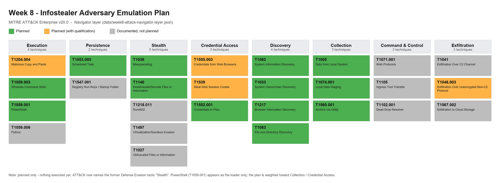
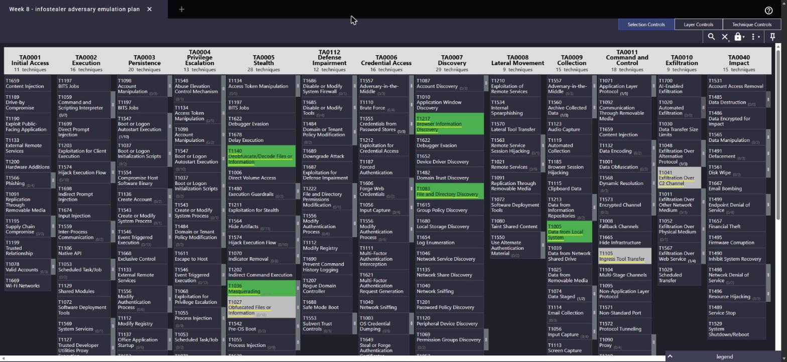
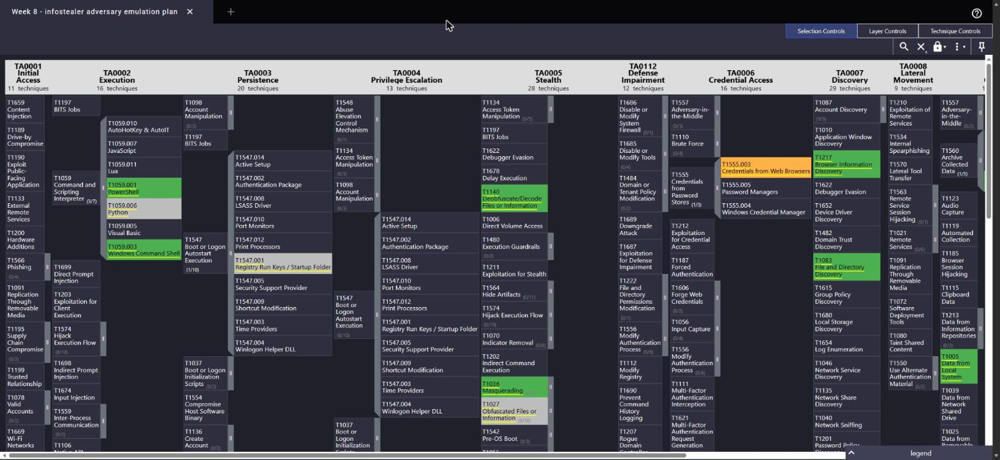

# Week 8 — Adversary Emulation Plan (Assignment 5)

## Project topic and task

**Forensic Analysis and Detection of Simulated Infostealer-Like Activity in Windows Environments**

> **Assignment numbering.** Our group numbers its submissions in order, so this Week 8 deliverable is **Assignment 5**. Note that the syllabus grading table (PDF page 9) instead pairs each number with a week — *Assignment 4 = week 8*, *Assignment 5 = week 9* — so by that table week 8 would be labelled "Assignment 4". Confirm the label the instructor expects before submission.

## On the choice of techniques (why this plan is not "just PowerShell")

The Weeks 6–7 exercise studied PowerShell (T1059.001). T1059 contains many other sub-techniques (Windows Command Shell, Python, AutoHotKey/AutoIT, JavaScript, Visual Basic and more), several of which fit an infostealer theme at least as well, so a plan built around a single interpreter would say little about what makes this threat an infostealer.

This shapes the plan. The defining behaviour of an infostealer is **not the scripting interpreter it is launched with — it is the credential and browser-data collection**. In our Week 4 reconstruction of ACR Stealer **Campaign 1**, PowerShell appears in the **delivery / loader** stage (it retrieves a ZIP stage and launches a bundled `pythonw.exe` loader), while access to browser-stored credentials, cookies and tokens and the archiving of data are reported later, in the payload's actions on objectives. Choosing PowerShell as *the* technique would therefore describe the loader, not the stealer.

Accordingly:

- The **weight of this plan is on the Collection and Credential-Access stages** (browser credentials, session cookies, files, local staging, archiving) — the behaviour that actually makes this an infostealer.
- **PowerShell is kept only where it is realistic** — the ClickFix loader step from Campaign 1 — and is explicitly labelled as the loader, not the stealer.
- Each stage uses the technique a real infostealer would use at that point, spread across the ATT&CK kill chain, rather than reusing one interpreter sub-technique.

## Continuity with earlier weeks

| Earlier work | Verified scope | How Week 8 uses it |
| --- | --- | --- |
| [Week 1](week1-cti-fundamentals.md) | Infostealer selected as the threat category. | The category this emulation models. |
| [Week 2](week2-data-collection.md) / [Week 3](week3-data-processing.md) | `looksta[.]icu` + two contextual IPs, handled as historical intelligence in MISP. | Source IOCs are **never contacted**; they only identify the campaign. |
| [Week 4](week4-cyber-kill-chain.md) | Kill Chain reconstruction of ACR Stealer **Campaign 1**, with evidence qualifiers. | **Primary CTI input** for the scenario below. |
| [Week 5](week5-threat-hunting.md) | Hypothesis-driven PowerShell hunt on native Event 400. | Re-used as the **loader-stage detection**. |
| [Weeks 6–7](week_6-7.md) | T1059.001 simulation + disclosed CAR-2014-04-003 adaptation. | Re-used as the **parent-process analytic**; its benign-match limits carry over. |

The emulation follows the MITRE Engenuity method: intelligence → TTPs → scenario → procedures → expected detections. It is not a replay of a specific real stealer and makes no infection claim.

## Rules of engagement and safety boundaries

1. **Isolated lab only.** A dedicated Windows VM with a pre-run snapshot, host-only/NAT networking, no production accounts or data, and no access to the real campaign infrastructure.
2. **Synthetic data only.** Reuse the Weeks 6–7 synthetic values (`FAKE-STUDENT`, `NOT-A-REAL-PASSWORD`, `https://training.invalid`) and add synthetic cookie / config files. No real browser profile, credential store, cookie database, or DPAPI secret is read.
3. **Local controlled receiver.** Any exfiltration sends synthetic data to a listener on `127.0.0.1` only. `looksta[.]icu` and the Week 2 IPs are never resolved or contacted.
4. **Reversible changes.** Every persistence entry, staging file, and archive is recorded and removed by a cleanup step; the VM is reverted to the snapshot afterwards.
5. **Stop conditions.** Stop if any step reaches outside the lab, touches a real credential path, or cannot be attributed to the plan.
6. **Separate evidence.** Week 9 collection goes under its own `evidence/week9-*/` with its own run ID. Review every command line for workspace paths and host/account identifiers **before** committing to the public repository.
7. **AI-use disclosure.** Per syllabus §9, generative-AI assistance is allowed only with the instructor's permission and must be disclosed (see end of report).

## Emulation scenario

The scenario abstracts Campaign 1 into the syllabus chain (**initial access → persistence → data exfiltration**), with the discovery and collection stages that define an infostealer. Each row keeps the Week 4 evidence qualifier for the real campaign and states the **safe** lab action. Tactic names are from Enterprise ATT&CK v20.0.

### Stage A — Initial access / delivery

| Step | Campaign 1 / infostealer basis | Safe lab action | ATT&CK | Tactic |
| --- | --- | --- | --- | --- |
| ClickFix lure | **Reported, limited.** User is instructed to paste and run a command. | A local static page on `127.0.0.1` shows a copy/paste instruction; the operator runs it manually. No malvertising, WebDAV, or remote DLL. | [T1204.004 Malicious Copy and Paste](https://attack.mitre.org/techniques/T1204/004/) | Execution* |
| Masquerade | Stealers pose as a legitimate installer/update. | The lure page and the dropped marker file are named like a fake update; nothing is signed or impersonated. | [T1036 Masquerading](https://attack.mitre.org/techniques/T1036/) | Stealth |

### Stage B — Execution (loader only)

| Step | Campaign 1 / infostealer basis | Safe lab action | ATT&CK | Tactic |
| --- | --- | --- | --- | --- |
| Command shell → PowerShell loader | **Reported.** `cmd.exe` → `rundll32.exe` → obfuscated PowerShell. | `cmd.exe` launches a PowerShell **loader** that prints a unique marker and runs the later steps. `rundll32`/remote-DLL (T1218.011) is **not** emulated. **This step models only the loader; the collection behaviour appears in Stage E.** | [T1059.003 Windows Command Shell](https://attack.mitre.org/techniques/T1059/003/), [T1059.001 PowerShell](https://attack.mitre.org/techniques/T1059/001/) | Execution |
| Decode staged command | **Reported.** PowerShell stage is obfuscated/encoded. | The loader Base64-decodes a benign marker command (as in Week 5). | [T1140 Deobfuscate/Decode Files or Information](https://attack.mitre.org/techniques/T1140/) | Stealth |

### Stage C — Persistence

| Step | Campaign 1 / infostealer basis | Safe lab action | ATT&CK | Tactic |
| --- | --- | --- | --- | --- |
| Logon scheduled task | **Reported.** Campaign 1 creates a hidden logon task. | `schtasks /create` registers a logon task running a benign marker script; recorded and removed in cleanup. | [T1053.005 Scheduled Task](https://attack.mitre.org/techniques/T1053/005/) | Persistence |

*Alternative (documented, not executed):* many infostealers persist with a **Run key** ([T1547.001](https://attack.mitre.org/techniques/T1547/001/)) instead, and a large class of stealers are **non-persistent** ("smash and grab"). Scheduled Task is chosen here because it is what our own Campaign 1 CTI reports.

### Stage D — Discovery (host fingerprinting)

| Step | Infostealer basis | Safe lab action | ATT&CK | Tactic |
| --- | --- | --- | --- | --- |
| Host / user fingerprint | Stealers fingerprint the host before collecting. | Run `systeminfo` / `whoami` equivalents in the lab VM. | [T1082 System Information Discovery](https://attack.mitre.org/techniques/T1082/), [T1033 System Owner/User Discovery](https://attack.mitre.org/techniques/T1033/) | Discovery |
| Browser/profile discovery | Stealers locate browser profiles and files. | Enumerate a lab folder holding the synthetic browser profile. | [T1217 Browser Information Discovery](https://attack.mitre.org/techniques/T1217/), [T1083 File and Directory Discovery](https://attack.mitre.org/techniques/T1083/) | Discovery |

### Stage E — Collection and credential access (the infostealer core)

| Step | Infostealer basis | Safe lab action | ATT&CK | Tactic |
| --- | --- | --- | --- | --- |
| Browser credentials | **Core.** DPAPI-protected browser logins. | Read the synthetic `mock-browser.json`. **No DPAPI and no real store is touched — access pattern only.** | [T1555.003 Credentials from Web Browsers](https://attack.mitre.org/techniques/T1555/003/) | Credential Access |
| Session cookies | **Core, modern stealers.** Cookie/token theft for session hijack. | Read a synthetic `cookies.json` with a fake token. Access pattern only. | [T1539 Steal Web Session Cookie](https://attack.mitre.org/techniques/T1539/) | Credential Access |
| Files with secrets | Stealers grab config / wallet / token files. | Read a synthetic `wallet.txt` / `config.ini` with training values. | [T1552.001 Credentials In Files](https://attack.mitre.org/techniques/T1552/001/) | Credential Access |
| Local collection | Read collected data from the host. | Gather the synthetic files read above. | [T1005 Data from Local System](https://attack.mitre.org/techniques/T1005/) | Collection |
| Stage and archive | Stealers stage into a temp folder, then archive. | Copy into a staging folder, then `Compress-Archive`. | [T1074.001 Local Data Staging](https://attack.mitre.org/techniques/T1074/001/), [T1560.001 Archive via Utility](https://attack.mitre.org/techniques/T1560/001/) | Collection |

### Stage F — Exfiltration

| Step | Campaign 1 / infostealer basis | Safe lab action | ATT&CK | Tactic |
| --- | --- | --- | --- | --- |
| Upload archive | **Not completed in the source.** Campaign 1 shows archiving as *preparation* for exfiltration. | **Planned** HTTP POST of the synthetic archive to a listener on `127.0.0.1` — a safe transfer of synthetic data, **not a performed exfiltration**. No C2 channel is used. | [T1048.003 Exfiltration Over Unencrypted Non-C2 Protocol](https://attack.mitre.org/techniques/T1048/003/) — the closest match for the planned HTTP POST | Exfiltration |

*Documented, not planned:* [T1041 Exfiltration Over C2 Channel](https://attack.mitre.org/techniques/T1041/) and [T1071.001 Web Protocols](https://attack.mitre.org/techniques/T1071/001/) describe exfiltration or communication over a C2 channel. They are **possible context** for this kind of campaign, not confirmed Campaign 1 actions: Microsoft's report supports contact with actor-controlled infrastructure and the preparation (archiving) of data, but not a completed transfer over a C2 channel. This plan establishes no C2 channel, so they are not planned steps; the planned loopback POST is T1048.003.

*Documented, not planned:* modern stealers often exfiltrate to a cloud or web service. [T1567.002 Exfiltration to Cloud Storage](https://attack.mitre.org/techniques/T1567/002/) covers Dropbox, Google Drive or OneDrive; related channels such as Telegram/Discord webhooks ([T1567.004](https://attack.mitre.org/techniques/T1567/004/)) and paste sites ([T1567.003](https://attack.mitre.org/techniques/T1567/003/)) are separate sub-techniques. The lab's transfer is loopback-only (`127.0.0.1`) and does **not** model any of these, so T1567.002 is recorded as context, not a planned step.

\* **Tactic honesty:** T1204.004 is classified under the **Execution** tactic in ATT&CK, not an "Initial Access" tactic; it is used here as the entry step, matching the Week 4 treatment. Kill Chain stage and ATT&CK tactic are different classifications.

### Techniques deliberately excluded

- **Reconnaissance / Weaponization** — "Not documented" in the Week 4 source; no technique is invented to fill the gap.
- **T1218.011 Rundll32** / remote-DLL loading — would require building and hosting a DLL.
- **T1059.006 Python loader** and **T1105 Ingress Tool Transfer** — modelled conceptually in Week 4, not executed here; the lab stays on native tooling.
- **T1102.001 Dead Drop Resolver** (blockchain C2) — a Campaign 1 *subset* variation only; also has no Atomic Red Team coverage.
- **T1497 Virtualization/Sandbox Evasion** and **T1027 Obfuscated Files** — characteristic anti-analysis behaviours worth naming for detection, but not part of the planned chain (T1497 has no Atomic Red Team coverage).
- **T1567.002 Exfiltration to Cloud Storage** — the cloud-storage exfil channel of real stealers (Dropbox / Google Drive / OneDrive); the lab transfer is loopback-only and does not model it, so it is documented, not planned.

## ATT&CK Navigator layer

The 27 techniques above are published as a Navigator layer at [`data/week8-attack-navigator-layer.json`](../data/week8-attack-navigator-layer.json) (layer format 4.5, ATT&CK v20.0, enterprise-attack). The figure below renders that layer; the live version opens at [mitre-attack.github.io/attack-navigator](https://mitre-attack.github.io/attack-navigator/) via **Open Existing Layer → Upload from local** and selecting the JSON file.

*Figure 1. The plan mapped to ATT&CK v20.0 — nothing is executed yet. Green — planned; amber — planned with a qualification (tactic note, access-pattern only, or extrapolation); grey — documented, not planned. The plan centres Collection and Credential Access; PowerShell (T1059.001) appears only as the loader. ATT&CK now names the former Defense Evasion tactic "Stealth" (the Stealth column).*

The same layer opened in the live MITRE ATT&CK Navigator (v5.3.2), shown across the full enterprise matrix:

*Figure 2. The published layer loaded in the official ATT&CK Navigator. The annotated techniques are highlighted in context across every tactic; sub-techniques (for example PowerShell and Windows Command Shell under T1059, and the credential sub-techniques under their parents) are collapsed onto their parent here, where Figure 1 lists each one individually.*

With annotated sub-techniques expanded in the same tool, the Execution tactic makes the loader choice explicit:

*Figure 3. Sub-techniques expanded in the live Navigator. Under T1059 Command and Scripting Interpreter, the plan's loaders — PowerShell (T1059.001) and Windows Command Shell (T1059.003) — are green, while Python (T1059.006), present in Campaign 1 but not planned, is grey, and the remaining family members (AutoHotKey & AutoIT, JavaScript, Lua, Visual Basic) are unused. Seeing PowerShell among its siblings is the direct answer to "why PowerShell": it is the loader this campaign used, chosen from the full T1059 family rather than by default. A companion capture (`week8-navigator-credaccess.jpg`) spans Credential Access to Exfiltration, showing T1555.003 Credentials from Web Browsers in amber, the planned non-C2 transfer T1048.003 in amber, and T1041, T1071.001 and T1567.002 greyed as documented-not-planned.*

*(Figures 2 and 3 and the Credential-Access/Exfiltration capture were all taken from the current layer. Figure 2 is the full-matrix overview with sub-technique expansion switched off for that view only, so sub-technique colours roll up to their parent (for example T1041 is grey; the amber T1048.003 sits under the collapsed T1048). The Exfiltration capture shows T1048.003 planned (amber) with T1041, T1071.001 and T1567.002 greyed.)*

## Expected detections

| Stage | Primary telemetry | Existing project detection | Known gap |
| --- | --- | --- | --- |
| A Delivery | `RunMRU` registry; Event 4688 / Sysmon 1 (`explorer.exe` → `cmd.exe`) | — (new for Week 9) | Manual paste leaves limited host evidence; Week 4 cites Microsoft's RunMRU hunting example. |
| B Execution | PowerShell **Event 400** + **4104** (script block); Event 4688 / Sysmon 1 | [Week 5 PowerShell hunt](week5-threat-hunting.md); [Weeks 6–7 CAR-2014-04-003](week_6-7.md) parent-not-explorer analytic | CAR analytic matches benign automation; Event 400 lacks parent identity; `pwsh.exe` parent artefacts must be excluded. |
| C Persistence | **Event 4698** (needs *Audit Other Object Access Events*); Sysmon 1 for `schtasks.exe` | [CAR-2013-08-001 Execution with schtasks](https://car.mitre.org/analytics/CAR-2013-08-001/) | 4698 off by default; Run-key alternative needs registry auditing / Sysmon 13. |
| D Discovery | Event 4688 / Sysmon 1 cmdlines (`systeminfo`, `whoami`, `reg query`) | — (new for Week 9) | Discovery commands are common and noisy; benign baseline needed. |
| E Collection | Sysmon 11 (archive file create); PowerShell 4104 for `Compress-Archive`; file-read auditing on the synthetic profile | — (new for Week 9) | File reads are not logged without file-system auditing; no DPAPI telemetry since DPAPI is not used. |
| F Exfiltration | Sysmon 3 (network connect) to loopback; listener access log | — (new for Week 9) | Loopback is not representative of real egress; no proxy/firewall telemetry in the lab. |

**Audit prerequisites for Week 9:** enable PowerShell Script Block Logging (4104), Process Creation auditing with command line (4688) or Sysmon, the scheduled-task audit subcategory (4698), and (for the Collection detections) file-system auditing on the synthetic profile folder. Weeks 6–7 recorded that Sysmon was absent and Security-log reads needed elevation on the previous PC — the Week 9 VM must fix this first, or the "new" detection rows cannot be evidenced.

## Hand-off to Week 9 (Atomic Red Team)

Week 9 executes selected [Atomic Red Team](https://github.com/redcanaryco/atomic-red-team) tests and analyses the results in a SIEM. Atomic test folders exist for every technique in the executed chain. Before running, open each technique's `atomics/<Txxxx>/Txxxx.yaml`, pick the specific test numbers, and confirm each test's inputs and `cleanup` match the rules of engagement above.

| Stage | Techniques to source atomics for |
| --- | --- |
| A Delivery | T1204.004, T1036 |
| B Execution | T1059.003, T1059.001, T1140 |
| C Persistence | T1053.005 (alt T1547.001) |
| D Discovery | T1082, T1033, T1217, T1083 |
| E Collection | T1005, T1555.003, T1539, T1552.001, T1074.001, T1560.001 |
| F Exfiltration | T1048.003 |

Do not assume an atomic is safe by its ID: read its `executor` and `cleanup` blocks first, substitute synthetic inputs, and run only in the snapshotted VM.

## Seven-to-eight-minute defense plan

| Time | Demonstrate or explain |
| --- | --- |
| 0:00–0:45 | Week 8 task and project topic; this is a **plan** derived from the Week 4 Campaign 1 CTI. |
| 0:45–1:40 | Technique choice: why the plan centres **Collection / Credential Access** and treats PowerShell as the loader, not the stealer. |
| 1:40–2:30 | Rules of engagement: VM snapshot, synthetic data, loopback receiver, reversible changes, stop conditions. |
| 2:30–5:00 | Walk Stages A–F and their ATT&CK techniques; show the Navigator layer. |
| 5:00–6:10 | Expected detections; where the Week 5 hunt and Weeks 6–7 CAR analytic plug in, and the audit prerequisites. |
| 6:10–7:00 | Honest limits: tactic vs Kill Chain stage for T1204.004; rundll32/DPAPI/Python/blockchain excluded; exfiltration is an extrapolation; credential steps are access-pattern only. |
| 7:00–7:30 | Hand-off to Week 9 Atomic Red Team; close on what the plan does and does not claim. |

## Limits and claims

This increment delivers a **plan and its ATT&CK mapping only**. It executes no technique, collects no new telemetry, and demonstrates no detection. It derives a safe, synthetic scenario from previously documented CTI, weights it toward the behaviour that defines an infostealer, and states the expected telemetry and project detections per stage. Precision, recall, and false-positive behaviour are out of scope until Week 9.

## Sources and provenance

- Syllabus 2026-2027, *Introduction to Threat Hunting*, section 3.3 (Week 8) and section 4 (grading).
- MITRE ATT&CK Enterprise v20.0 (released 13 October 2026); technique and tactic names from the v20.0 STIX bundle. Technique pages linked above.
- [MITRE CAR-2014-04-003](https://car.mitre.org/analytics/CAR-2014-04-003/) and [CAR-2013-08-001](https://car.mitre.org/analytics/CAR-2013-08-001/).
- MITRE Engenuity Adversary Emulation Library / CALDERA documentation (emulation-plan method).
- [Microsoft Security Research, *ACR Stealer* report](https://www.microsoft.com/en-us/security/blog/2026/07/16/acr-stealer-two-observed-intrusion-chains-amid-increased-threat-activity/), 16 July 2026 — Campaign 1 behaviours, via [Week 4](week4-cyber-kill-chain.md).
- Repository [Week 4](week4-cyber-kill-chain.md), [Week 5](week5-threat-hunting.md), and [Weeks 6–7](week_6-7.md) documentation.

**AI-use disclosure:** an AI assistant helped interpret the syllabus requirement, verify ATT&CK v20.0 technique IDs and tactics, cross-check Atomic Red Team and CAR coverage, and draft this plan and the Navigator layer. No attack code was executed in preparing this document. The group should review the plan and follow the course's AI-use and disclosure requirements before presenting or submitting it.
