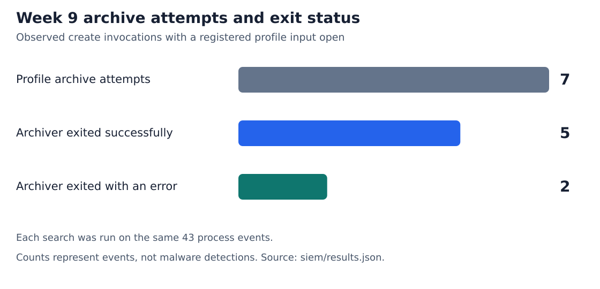
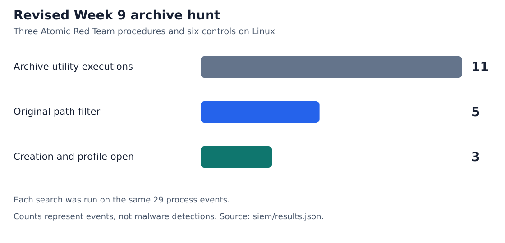
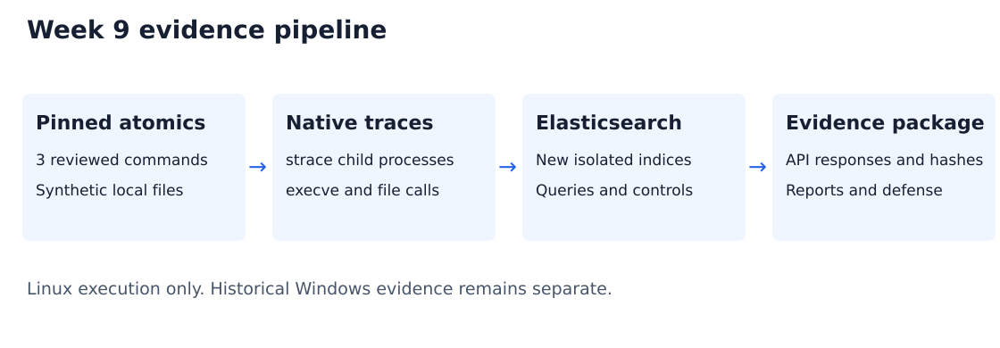
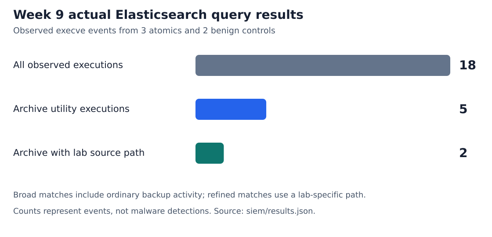

# Week 9 - Atomic Red Team execution and SIEM analysis

Project: **Forensic Analysis and Detection of Simulated Infostealer-Like Activity in Windows Environments**. Prepared 8 November 2026. This increment addresses syllabus 2026-2027 section 3.3, Week 9: execute selected atomic tests and record/analyze their results in a SIEM. The examples T1059 and T1003 are illustrative; credential dumping is not required for this chosen experiment.

## Windows archive and Security audit · 12 November 2026 (Almaty)

On a fresh GitHub-hosted **Windows Server 2022 Datacenter** VM (build 20348), Windows bsdtar 3.8.9 archived a mock browser profile. Six processes ran at 19:55:22 UTC on 11 November, or 00:55:22 on 12 November in Almaty. This is the group's Windows adaptation of the archive scenario. The three upstream Atomic Red Team procedures and their Linux results are documented below. [Windows run](https://github.com/User-ease/simulated-infostealer-threat-hunting/actions/runs/43091627096) · [Collector at the executed commit](https://github.com/User-ease/simulated-infostealer-threat-hunting/blob/024f84d96d1011f7e09b1b2ec3286018223943b0/scripts/collect_week9_windows.ps1)

### Evidence and query

The collector enabled successful Process Creation and File System auditing, included command lines, and applied an inheritable audit rule (SACL) to a fresh fixture directory. It exported Security XML for the six measured tar processes, restricting file events to that directory. Independent extractions verified the SHA-256 of the member of every newly created archive. Extraction processes were excluded from the measured PIDs. The collector removed the fixture and restored the audit settings. [Native XML](../evidence/week9-windows/43091627096/events.xml) · [Manifest, process exits and member hashes](../evidence/week9-windows/43091627096/manifest.json)

Elasticsearch 9.5.5 indexed **6 process starts (4688)** and **14 object accesses (4663)**. The first EQL search found four create-mode processes. The second found three processes reading the registered profile file. The sequence returned two pairs. It joins the host, normalized PID and effective logon ID, in event order within ten seconds. For 4688 it uses the new PID and the target logon when populated, otherwise the subject logon. For 4663 it uses the accessing PID, subject logon, exact registered file path and ReadData mask bit 0x1. A directory listing can use that bit too, which is why file identity matters. Case names and expected outcomes are used only for scoring. [Create query](../evidence/week9-windows/43091627096/siem/create.json) · [Read query](../evidence/week9-windows/43091627096/siem/read.json) · [Sequence and full response](../evidence/week9-windows/43091627096/siem/correlated.json)

| Windows control | PID | Create-mode 4688 | Profile ReadData 4663 | Pair expected / observed | Exit |
| --- | ---: | ---: | ---: | --- | ---: |
| Archive the synthetic profile with short options | 5116 | 1559826 | 1559829 | Yes / Yes | 0 |
| Back up ordinary documents with a different file also named cookies.json | 1108 | 1559842 | — | No / No | 0 |
| Back up ordinary documents into browser-profile-backup.tar | 5812 | 1559858 | — | No / No | 0 |
| List the completed profile archive | 724 | — | — | No / No | 0 |
| Authorized profile backup using --create and --file= | 6392 | 1559876 | 1559879 | Yes / Yes | 0 |
| Try to list the raw profile JSON as an archive | 3980 | — | 1559893 | No / No | 1 |

An em dash means that record did not meet the column predicate. Each process has a native 4688. All six outcomes agreed with the manifest. Process 3980 read the correct file but invoked list mode and returned an invalid-archive error. Process 6392 legitimately backed up the same profile and triggered the rule. The rule therefore identifies a behavior suitable for triage. [Case matrix](../evidence/week9-windows/43091627096/siem/summary.json)

**Record walkthrough.** At 19:55:22.6852380 UTC, 4688 record 1559826 gives NewProcessId 0x13fc (5116) and a tar -cf command. About 65 ms later, 4663 record 1559829 gives ProcessId 0x13fc, logon 0x94dcb, the exact profile input and AccessMask 0x1. The archive member extracted by the verifier matched the original SHA-256 `f686c9ef781b0952ce997b3c4f65805cdea1158b39c6e31d9aae534e31f7f8b1`. The exit code and member hash come from the harness. The Security pair establishes a create invocation followed by an audited read. Neither process intent nor transfer is observable from this pair. [Microsoft event 4688](https://learn.microsoft.com/en-us/windows/security/threat-protection/auditing/event-4688) · [Microsoft event 4663](https://learn.microsoft.com/en-us/windows/security/threat-protection/auditing/event-4663)

### Reproduce the Windows result

1. On a disposable Windows VM with built-in tar.exe, open elevated PowerShell in the repository root and run the collector below. The output directory must be new. Alternatively, run the **Week 9 Windows Security audit** workflow from GitHub Actions and extract its artifact.
2. To replay the published native XML, use Python 3.9+ and a loopback teaching Elasticsearch instance. Run the second command in the repository root, pointing --url at that instance. It creates a fresh index and writes new requests, responses, hashes and the checked matrix to the output directory. To score a fresh collection, substitute its directory for the published one.

```powershell
./scripts/collect_week9_windows.ps1 -OutputDirectory C:/Temp/week9-evidence
```

```sh
python3 scripts/analyze_week9_windows.py evidence/week9-windows/43091627096 windows-replay --url http://127.0.0.1:19219
```

The profile path is registered by the lab and the parser covers the bsdtar syntax used in the controls. The collector checks that each measured PID is unique in the run. Broader deployment would need a maintained file inventory and process-lifetime tracking for PID reuse. One filtered Windows host and six benign controls cannot estimate a production false-positive rate. [Replay script](../scripts/analyze_week9_windows.py)

## Archive attempts and exit status · 12 November 2026

Version 3 ran three atomics and twelve controls. Elasticsearch indexed 43 process executions, including 18 tar/gzip launches. Seven archiver invocations opened a registered profile input in create mode. Five exited with code 0 and two with code 2. Independently reading the five successful outputs before cleanup reproduced the expected training data. [Executed queries](../evidence/week9/20261111T192612720530Z/siem/queries.json) · [15 case results](../evidence/week9/20261111T192612720530Z/siem/summary.json) · [Archive checks](../evidence/week9/20261111T192612720530Z/collection.json)



| Control | Attempts | Exit 0 | Failed | Additional evidence |
| --- | ---: | ---: | ---: | --- |
| `tar --create --file=out/long.tar profile-alt` | 1 | 1 | 0 | Both expected members matched the input bytes. |
| `tar --gzip --file out/separate.tar.gz --create --verbose profile-alt` | 1 | 1 | 0 | Both members matched after decompression. |
| List / extract with long options | 0 / 0 | 0 / 0 | 0 / 0 | Each command completed normally. |
| Write to `/dev/full`, short / long creation flags | 1 / 1 | 0 / 0 | 1 / 1 | Both traces show a profile open, a kernel ENOSPC write error and exit 2. |

The analyzer parses option arguments, including both forms of `--file`. The attempt query requires a recognized create invocation and a successful read-only open of a registered input by the same process image. The success and failure queries add an exit-code condition. Exit status comes from that PID’s native trace. An image replaced by a later exec, or missing an exit record, cannot qualify for either exit bucket. The original wildcard is retained for comparison. All 60 expected counts (15 scenarios × 4 case-level queries) agreed with Elasticsearch. The 20 separate synthetic assertions still cover the wildcard and broad utility queries.

**Trace walkthrough.** In the long write-error case, lines 12–13 show the input files, line 14 records ENOSPC and line 22 records exit 2. The positive long-form control exits 0 and its archive passes member verification. In applications beyond this lab, a zero exit status is the exit status of the utility. Verification of what went into an archive still requires artifact evidence. A legitimate backup can meet all of these conditions. [Failure trace](../evidence/week9/20261111T192612720530Z/traces/long_write_error.39445) · [Successful trace](../evidence/week9/20261111T192612720530Z/traces/long_equals.39418) · [Full search responses](../evidence/week9/20261111T192612720530Z/siem/results.json)

## Earlier nine-scenario run · 12 November 2026

On the expanded run, Elasticsearch indexed **29** process executions across three atomics and six controls. Eleven events launched tar or gzip. The original argument filter selected five events. The revised query selected three: the atomic gzip, the atomic tar and a normal backup of the same training profile under a different directory name. All nine expected counts for each query matched the live responses. [Queries](../evidence/week9/20261111T190107852073Z/siem/queries.json) · [Case results](../evidence/week9/20261111T190107852073Z/siem/summary.json) · [Full responses](../evidence/week9/20261111T190107852073Z/siem/results.json)



| Executed case | Original | Revised | What the control establishes |
| --- | ---: | ---: | --- |
| Atomic gzip of the mock browser record | 1 | 1 | gzip opened the expected source for reading. |
| Atomic tar of the training profile | 1 | 1 | tar opened both profile files. |
| Ordinary backup, including an unrelated file named cookies.json | 0 | 0 | A matching basename does not establish source identity. |
| Ordinary backup into out/lab-browser-backup.tar.gz | 1 | 0 | The marker occurs only in the output filename. |
| List that archive with tar -tf | 1 | 0 | Listing archive members creates no archive. |
| Archive the training profile copied to profile-alt | 0 | 1 | Known input bytes identify the controlled copies. A legitimate profile backup is a candidate. |
| Decompress the existing gzip to stdout | 1 | 0 | Decompression falls outside the creation modes. |
| Shell atomic / plain shell control (two executions of the harness) | 0 / 0 | 0 / 0 | Neither case launches an archiver. |

Before the run, the harness hashes the two training profile files and records the relative paths of fixtures with those bytes. strace records the resolved path on the **returned descriptor** with `-y`; the collector replaces the absolute lab root with `/lab` in the published traces. The analyzer enriches each supported tar/gzip creation event with successful read-only opens of registered inputs by that PID, after its exec and before its next successful exec. Elasticsearch requires the creation mode and at least one supporting trace line. The query uses no case label. The normalized exec records remain available alongside the enriched search hits. [Fixture manifest](../evidence/week9/20261111T190107852073Z/collection.json) · [Analyzer](../scripts/analyze_week9_elastic.py)

For the renamed profile, trace lines 12–13 record opens for the synthetic browser and cookie files. Compare them with the destination-only command in the table. An open for reading establishes file access; the independent gzip/tar byte checks confirm the contents for the original two atomic cases. The 20 synthetic assertions in the regression index cover the broad selector and historical wildcard. The nine paired live control outcomes above test the revision. [Renamed-profile trace](../evidence/week9/20261111T190107852073Z/traces/renamed_profile.15333) · [Regression results](../evidence/week9/20261111T190107852073Z/siem/regression.json)

**Scope.** The parser recognizes the tar short-option creation forms ending in `f` and gzip compression options used here. Unsupported invocations, renamed executables and missing file-open telemetry can be missed. A changed browser database needs an updated asset inventory. The controlled file hashes make this test repeatable; they are unsuitable as general indicators of credential theft. The Windows evidence and sensor requirements are in the [Week 10 artifact analysis](week10-apt29-analysis.md#windows-artifacts-and-their-evidentiary-limits).

## Original run of 8 November 2026

Three official Linux Atomic Red Team tests and two benign controls completed successfully. Native child-process tracing recorded **18 successful execve events**. Elasticsearch 9.5.5 indexed all 18; the broad archive query returned **5 events**, and the source-path refinement returned **2 events** belonging to `atomic_gzip` and `atomic_tar`. All **20 query boundary assertions** passed in a separate synthetic index. Archive integrity and cleanup checks passed.

**Original run platform:** the 8 November host ran Linux. This is a portable extension of the Windows-focused project, validating shell execution and archive behavior. It does not validate Windows PowerShell, browser credential decryption, cookie theft, persistence or exfiltration. The Week 8 Windows plan remains a plan for those stages; this run is not represented as its full execution.



## Atomic selection and provenance

Source commit: [`a0e3f9bc69fed2fd711bd1f1aa87a40c33482fe6`](https://github.com/redcanaryco/atomic-red-team/tree/a0e3f9bc69fed2fd711bd1f1aa87a40c33482fe6). Test GUIDs, original executor strings, supported platforms, source URLs and YAML SHA-256 values are in [selected-atomics.json](../data/week9/selected-atomics.json). The relevant source snippets retain the [upstream MIT license](../data/week9/ATOMIC-RED-TEAM-LICENSE.txt).

| Technique / test number at pin | Test name | GUID | Substituted inputs |
| --- | --- | --- | --- |
| T1059.004 / 8 | Command line scripts | b04ed73c-7d43-4dc8-b563-a2fc595cba1a | None; five harmless shell markers |
| T1560.001 / 6 | Data Compressed - nix - gzip Single File | cde3c2af-3485-49eb-9c1f-0ed60e9cc0af | `input_file=lab-browser/mock-browser.json`; fallback content is a training marker |
| T1560.001 / 7 | Data Compressed - nix - tar Folder or File | 7af2b51e-ad1c-498c-aca8-d3290c19535a | `input_file_folder=lab-browser`; `output_file=out/browser.tar.gz` |

The selected executor commands were run manually under a custom Python/strace wrapper. This is **not an Invoke-AtomicRedTeam run**. The [Atomic Red Team getting-started guidance](https://github.com/redcanaryco/atomic-red-team/wiki/Getting-Started) supports reviewing and executing the individual test procedure. No dependency installer or unreviewed upstream payload was run. [T1059.004 source](https://github.com/redcanaryco/atomic-red-team/blob/a0e3f9bc69fed2fd711bd1f1aa87a40c33482fe6/atomics/T1059.004/T1059.004.yaml), [T1560.001 source](https://github.com/redcanaryco/atomic-red-team/blob/a0e3f9bc69fed2fd711bd1f1aa87a40c33482fe6/atomics/T1560.001/T1560.001.yaml).

## Environment and collection

The collector generated `lab-browser/mock-browser.json`, `lab-browser/cookies.json` and `ordinary-docs/notes.txt` within a new evidence directory. Values include `FAKE-STUDENT`, `NOT-A-REAL-PASSWORD`, an invalid session marker and `https://training.invalid`. There are no real browser profiles or account credentials.

`strace -ff -ttt` followed each launched process tree and recorded `execve`, `openat`, `unlink`, `unlinkat` and `rename`. The normalized dataset contains only successful `execve` calls; failed executable lookups are excluded. File-operation traces remain available for examination but are not indexed as a complete file-access dataset. Collection is limited to the selected child processes, not system-wide monitoring. Each event retains the raw trace filename and line number.

The event label is `event.dataset=lab.strace`; `host.name=LAB-LINUX` is a fixed pseudonym, and no actual hostname was collected. Commands use relative lab paths so public evidence does not expose the user's home path. Process IDs and native timestamps are retained. The synthetic-case labels are added by the harness and are used for evaluation, not query selection.

Run ID: `20261108T145956001720Z`. Collection: **8 November 2026 14:59:56-15:00:01 UTC**, or **19:59:56-20:00:01 Asia/Almaty**. These times are actual execution times. Earlier Windows evidence is not reused as new Week 9 telemetry.

| Case | Type | Exit code | Successful execve events |
| --- | --- | --- | --- |
| `atomic_shell` | Official atomic | 0 | 7 |
| `atomic_gzip` | Official atomic | 0 | 2 |
| `atomic_tar` | Official atomic | 0 | 4 |
| `benign_backup` | Benign control | 0 | 4 |
| `plain_control` | Benign control | 0 | 1 |

## Outcome and cleanup checks

The shell test printed exactly five expected lines. The gzip round trip reproduced the source file bytes. The tar archive contained the expected mock-browser and cookie files, and their extracted byte streams matched the original inputs. The tar test ran after gzip, so it also included `mock-browser.json.gz`; the exact member list is recorded in the collection manifest. No archive was extracted onto the filesystem during validation.

SHA-256 values were captured before cleanup. The upstream cleanup commands removed the gzip and tar outputs; the ordinary backup was also removed. Synthetic input files, native traces, output streams and manifests remain as reproducibility evidence. The [collection manifest](../evidence/week9/20261108T145956001720Z/collection.json) records each command, its timing, its exit status, input substitutions, checks and cleanup results.

## SIEM implementation and findings on 8 November

The dedicated Elasticsearch node uses [week9-elasticsearch.yml](../config/week9-elasticsearch.yml), with its HTTP listener on `127.0.0.1:19209`. Kibana uses [week9-kibana.yml](../config/week9-kibana.yml) at `127.0.0.1:15609`. These are new loopback-only teaching services with authentication disabled in this isolated configuration; the configuration must not be reused on a shared server. No existing service or security agent was reconfigured.

This is an Elastic hunting pipeline with custom collection and Query DSL. It does not configure the Elastic Security detection engine, production integration or scheduled alerts. The [analyzer](../scripts/analyze_week9_elastic.py) verifies collection hashes before ingestion, creates a new index, uses create-only bulk operations and saves actual API requests/responses. A second ingestion into the same evidence directory or index is refused.

Index: `lab-week9-20261108t145956001720z`. The normalizer lowercases executable names; arguments retain their values. The queries do not filter on `lab.case`, test GUIDs or expected labels.

| Query | Predicate | Actual events | Interpretation |
| --- | --- | --- | --- |
| Inventory | `event.dataset = lab.strace` | 18 | All successfully traced executions |
| Archive utility | Inventory + `process.name IN (tar, gzip)` | 5 | Includes ordinary backup and tar's gzip children |
| Lab browser archive | Archive utility + an argument containing `lab-browser` | 2 | Direct gzip and tar cases referencing the synthetic browser source |



The figure is generated from the saved Elasticsearch responses; it is not a Kibana screenshot. A tar invocation can launch a shell and a gzip child, so counts of events and counts of tests differ. The child gzip processes have no browser-source argument and drop out of the refined search.

The ordinary document backup is a deliberate benign match to the broad query. The refined predicate distinguishes our controlled inputs but has an obvious dependency on the lab path. A production rule would need file-access context, process ancestry, source sensitivity, baseline backup behavior and transfer evidence. Legitimate browser backups could still match. No precision, recall or production false-positive estimate is justified by this small, entirely benign dataset.

A separate `-regression` index contains ten synthetic boundary documents: browser tar, browser gzip, ordinary backup, shell wrapper, missing name, uppercase name, missing arguments, a different executable name, empty arguments and a renamed-binary gap. The two predicates produced their expected results in all 20 assertions. These are query-semantics checks, not additional endpoint observations or evidence of malicious activity.

## Evidence inventory

| Artifact | Meaning |
| --- | --- |
| [collection.json](../evidence/week9/20261108T145956001720Z/collection.json) | Commands, outcomes, archive checks and cleanup |
| [events.jsonl](../evidence/week9/20261108T145956001720Z/events.jsonl) and [traces/](../evidence/week9/20261108T145956001720Z/traces/) | Normalized real observations and their raw syscall sources |
| [collection-sha256.json](../evidence/week9/20261108T145956001720Z/collection-sha256.json) | Byte-integrity inventory of collection files |
| [SIEM summary](../evidence/week9/20261108T145956001720Z/siem/summary.json) | Counts, matching cases and assertion status |
| [queries.json](../evidence/week9/20261108T145956001720Z/siem/queries.json), [results.json](../evidence/week9/20261108T145956001720Z/siem/results.json) | Executed queries and full search responses |
| [api-transcript.json](../evidence/week9/20261108T145956001720Z/siem/api-transcript.json) | Actual Elasticsearch calls and responses, including separate fixtures |
| [runtime.json](../evidence/week9/20261108T145956001720Z/siem/runtime.json), [regression.json](../evidence/week9/20261108T145956001720Z/siem/regression.json) | Server-reported version and case-by-case query checks |
| [SIEM hashes](../evidence/week9/20261108T145956001720Z/siem/sha256.json) | Integrity inventory of analysis outputs |

## Reproduction

Requirements: Linux, Python 3.9+, strace, sh, tar, gzip, seq and sleep. The Python collectors require no third-party packages. Elasticsearch/Kibana 9.5.5 were downloaded from the official Elastic archive distribution and verified against vendor SHA-512 files. [Elastic archive-installation documentation](https://www.elastic.co/docs/deploy-manage/deploy/self-managed/install-elasticsearch-from-archive-on-linux-macos).

From a writable repository checkout:

1. Extract the verified Elasticsearch and Kibana archives outside the repository. Copy the supplied YAML configurations into their respective `config/` directories. Use `ES_JAVA_OPTS='-Xms512m -Xmx512m'` for this small lab and run Elasticsearch as a normal user. Start Kibana with `NODE_OPTIONS=--max-old-space-size=768`.
2. Run the collector, then pass its printed new evidence directory to the analyzer:

```bash
python3 scripts/collect_week9_atomics.py
python3 scripts/analyze_week9_elastic.py evidence/week9/<NEW_RUN_ID>
python3 -m unittest discover -s tests -v
```

3. Select the exact index of the run in Kibana with `@timestamp` as the time field. For the current published run use `lab-week9-20261111t192612720530z` and 2026-11-11 19:26:10–19:26:20 UTC. The earlier nine-scenario run uses `lab-week9-20261111t190107852073z` and 19:01:07–19:01:15 UTC. The 8 November archive uses 14:59:50–15:00:10 UTC on that date.
4. Run the matching version’s saved DSL in Dev Tools. In version 3 show `process.command_line`, `process.exit_code`, `lab.source_file`, `lab.profile_open_lines` and `lab.exit_line`. Compare `profile_archive_attempt`, `lab_browser_archive` (exit 0) and `failed_profile_archive` (nonzero exit). In the two older collections the native exit records were unavailable.
5. Keep the original evidence unchanged. A rerun gets a new run ID, directory and index. Stop only the dedicated lab services when finished; the indices persist in their own data directories.

## Continuity and limitations

Week 8 planned a longer Windows sequence. This increment executes a deliberately small subset using supported Linux procedures. T1059.004 is Unix Shell, not T1059.001 PowerShell. T1560.001 applies to the archive utility behavior; its mapping does not prove credential theft, a malicious objective or exfiltration. The [Week 10 APT29 analysis](week10-apt29-analysis.md) connects source-reported behavior to this evidence with explicit qualifiers.

Both increments were prepared on 8 November 2026, with separate commits using actual timestamps. That provides transparent change separation but cannot establish historical weekly commit cadence. The group still needs to give the [7-8 minute defense](weeks9-10-defense.md).

**AI assistance:** OpenAI Codex assisted with source review, test selection, code, execution, validation, figures and writing. The group should review and understand the material and follow the course's AI-permission and disclosure requirements. Instructor permission is not asserted here.
